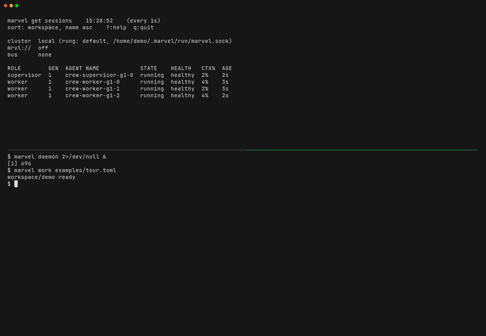
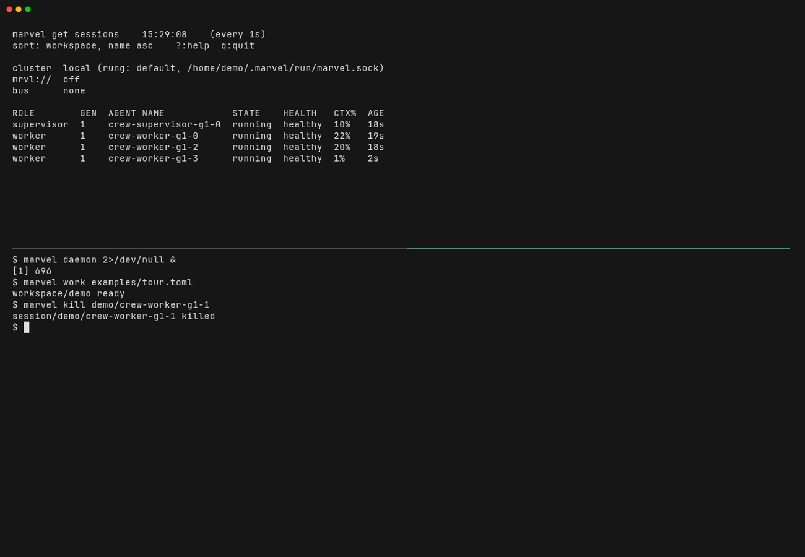
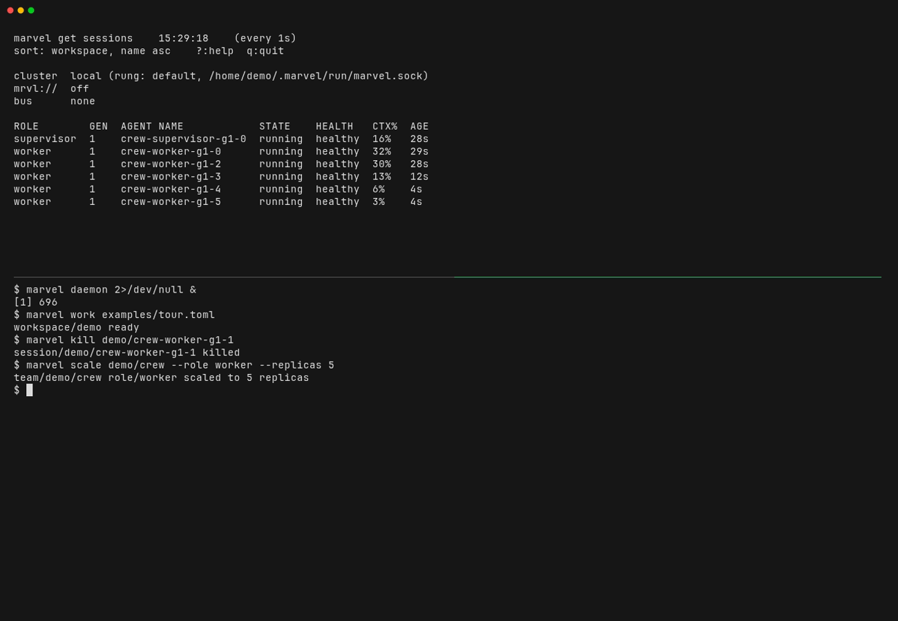
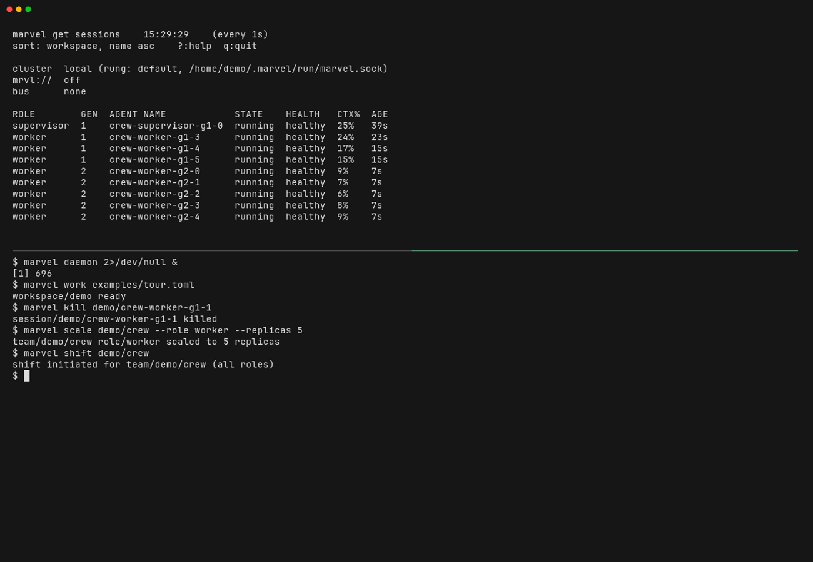

# Tour

This tour walks the core loop in about three minutes: declare a team, let marvel make it true, lose a session, scale a role, and shift the team to a new generation. It runs on the simulator, so it needs no model login and costs nothing. A [recording](media/tour.mp4) of the same steps, made from [`media/tour.tape`](media/tour.tape), shows each one.

## Before you start

Build the binaries and have `tmux` on your PATH:

```sh
just build
export PATH="$PWD/bin:$PATH"
```

Run the tour on a scratch layout if the machine already runs marvel; the section "Run the acts on a scratch layout" in [the four-act demo](demo.md) shows how, and the tour does not repeat it.

## Declare a team

`examples/tour.toml` is the whole team. It is a manifest of one workspace (`demo`), one team (`crew`) and two roles:

```toml
[workspace]
name = "demo"

[[team]]
name = "crew"

  [[team.role]]
  name = "worker"
  replicas = 3

    [team.role.runtime]
    image = "simulator"
    command = "../bin/simulator"
    args = ["--tick", "1000"]

    [team.role.healthcheck]
    type = "heartbeat"
    timeout = "10s"
    failure_threshold = 3
```

The supervisor role has the same shape with `replicas = 1` and a slower tick. A role names the command each session runs and how many sessions there are. The `healthcheck` says how marvel knows a session is alive: here, a heartbeat the simulator sends, which marvel declares missed after 10 seconds. A relative `command` is resolved from the manifest's directory, which is why the path starts with `../`.

## Make it true

Start the daemon, load the manifest, and watch in a second terminal:

```sh
marvel daemon &
marvel work examples/tour.toml
marvel get sessions -w 1 --columns role,generation,name,state,health,context,age
```



`marvel get sessions` redraws every second. Four rows appear: `crew-worker-g1-0` to `-g1-2` and `crew-supervisor-g1-0`. `GEN` is the generation the session belongs to. `HEALTH` turns `healthy` within a few seconds of the first heartbeats. `CTX%` is how full the session's context window is; on the simulator it climbs on a schedule, and it is not a real model's reading. `--columns` keeps the table narrow enough to show `GEN`; without it, a terminal narrower than the full table hides columns.

## Lose a session

```sh
marvel kill demo/crew-worker-g1-1
```



The row goes at once. About two seconds later, on a reconcile tick, marvel sees the role is one short and starts a replacement. It takes the next index, so the new row is `crew-worker-g1-3`, not a second `g1-1`.

## Scale

```sh
marvel scale demo/crew --role worker --replicas 5
```



Two more worker rows appear. Scaling changes the declared count; marvel makes it true the same way it replaced the killed session.

## Shift

```sh
marvel shift demo/crew
```



A shift swaps every session for a fresh one. The new generation starts first, all workers together. Once they are ready, the old workers drain one per tick. The supervisor shifts last, so the team is never without it. `GEN` moves from 1 to 2, and for about 20 seconds both generations are in the table. A long-running agent sheds stale context this way without the team going dark.

## Read the record

```sh
marvel events
```

Everything marvel did is in the event log: `session.created` and `session.deleted` for each session (a kill shows as deleted), `team.shift-started`, and `team.shift-role-ready` as each role's new generation passes its gate. A scale emits no event of its own; read it from the `session.created` lines that follow.

## Clean up

```sh
marvel stop --teardown
```

`--teardown` stops the daemon and ends every session. A plain `marvel stop` leaves the sessions running for the next daemon to adopt.

## With real agents

Swap `image` and `command` for `claude`, `codex` or `opencode` and the same commands apply. Start from [`examples/claude.toml`](../examples/claude.toml), then read the [User Guide](user-guide.md) and the [feature matrix](feature-matrix.md), which says which features work for which harness. For recovery cases, permission projection and budgets, go on to [the four-act demo](demo.md).
